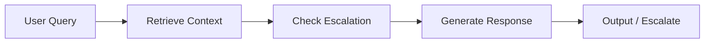

# Smart Support Agent

RAG-powered customer support agent with automatic escalation routing, built with LangGraph and FAISS.

## Features

- Retrieval-Augmented Generation over a product knowledge base
- Automatic escalation detection for sensitive issues (billing, data loss, legal)
- Conversation history maintained across turns
- Custom knowledge base support via `--kb-dir`
- Clean, typed state management with LangGraph

## Architecture



## Tech Stack

- **Framework**: LangGraph
- **Vector Store**: FAISS
- **LLM**: GPT-4o-mini
- **Embeddings**: OpenAI Embeddings

## Setup

```bash
pip install -r requirements.txt
cp .env.example .env
# Add your OPENAI_API_KEY to .env
```

## How to Run

```bash
# Interactive mode with built-in knowledge base
python agent.py

# Use your own knowledge base (.txt / .md files)
python agent.py --kb-dir docs/
```

## Example

```
Customer: How do I reset my password?
Agent: Go to the login page, click 'Forgot Password', and enter your email. The reset link expires in 1 hour.

Customer: I want a full refund, this is fraud!
Agent [ESCALATED]: I understand your concern... Your case ID is #48291.
```

## Future Improvements

- Persistent conversation memory with a vector store per session
- Multi-language support
- Integration with ticketing systems (Zendesk, Intercom)

---

**Created by Adnan Raza**
